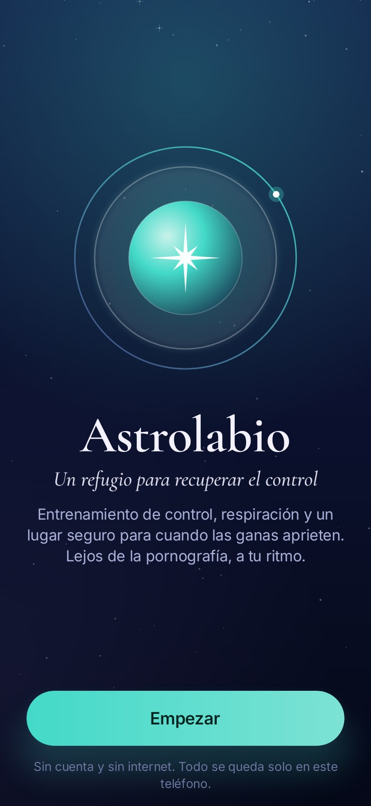
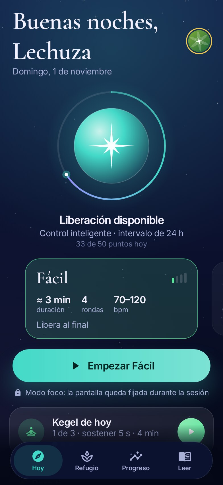
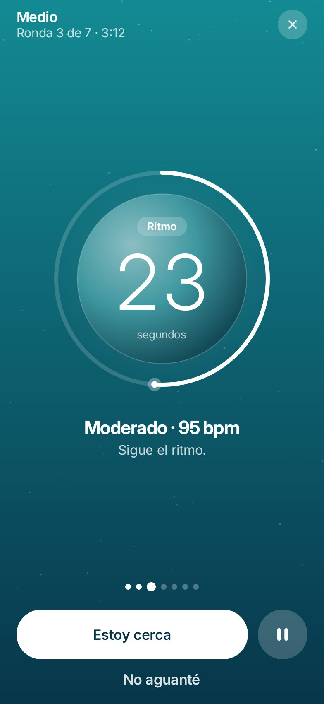
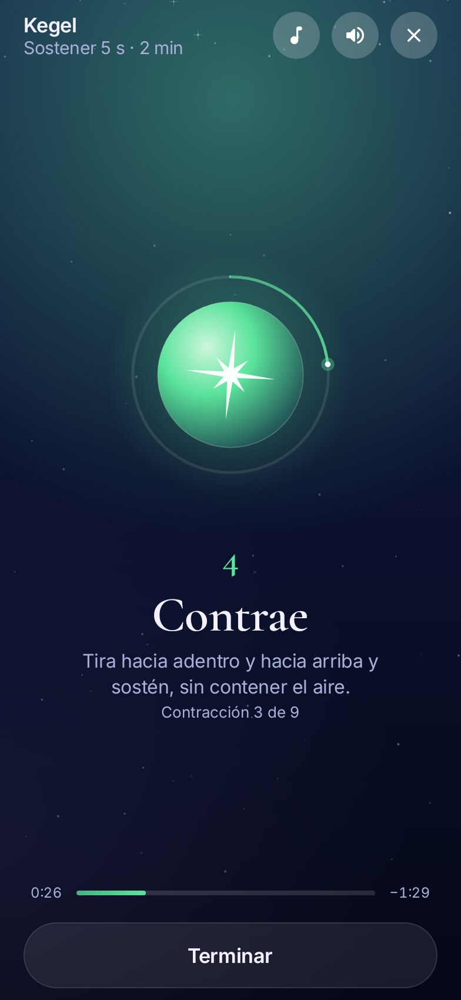
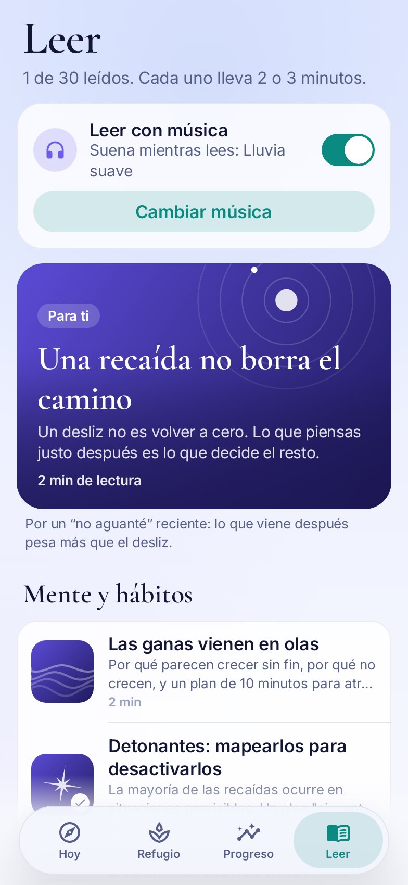

<p align="center">
  
</p>

<h1 align="center">Astrolabio</h1>

<p align="center"><i>Compasso en portugués · Lodestar en inglés</i></p>

<p align="center">
  <b>Un refugio para recuperar el control.</b><br>
  Deja la pornografía a tu ritmo, con entrenamiento de control, Kegel, respiración y lecturas basadas en la ciencia.<br>
  100% sin conexión · sin anuncios · sin rastreo · código abierto
</p>

<p align="center">
  <a href="https://github.com/H3yK0/Compasso/releases/latest"></a>
  
  
</p>

<p align="center"><a href="README.md">English</a> · <a href="README.pt-BR.md">Português</a> · <b>Español</b></p>

<p align="center">
  
  
  
  
  
</p>

## Qué hace

- **Entrenamiento de control.** Sesiones con el método de "parar y volver a empezar", usado en la terapia sexual:
  rondas de ritmo con un pulso que se acelera, pausas totales con respiración guiada, el botón "Estoy cerca" para
  parar en el momento y el botón honesto "No aguanté". Cinco niveles y reglas inteligentes que espacian las
  liberaciones para que la prisa no decida por ti.
- **Kegel.** Entrenamiento del suelo pélvico, el músculo del control, hasta 3 veces al día: niveles de permanencia
  (3 a 10 s, liberados de a poco) y de tiempo (2 a 6 min), con vibración en cada cambio para entrenar con los ojos
  cerrados.
- **Un refugio para cuando las ganas aprietan.** Dos minutos de respiración guiada con 6 músicas tranquilas generadas
  en vivo por la app y tres juegos originales para ocupar la cabeza hasta que pase la ola.
- **30 lecturas con fuentes.** Artículos cortos sobre las ganas, los hábitos, la recaída, la vergüenza, el estrés, el
  sueño, el alcohol, la ansiedad de desempeño, las relaciones y el Kegel, cada uno con sus estudios al final. Se pueden
  leer con música tranquila.
- **Recomendaciones que explican el porqué.** Un algoritmo local mira tus sesiones y tropiezos y sugiere el próximo
  nivel y la próxima lectura, siempre mostrando el motivo.
- **Progreso por constancia.** Los puntos premian aparecer, no "hacer más": check-in, Kegel, respirar, leer. Niveles de
  Principiante a Invicto, el cielo del mes, gráficos y récords.

## La privacidad primero

- **Sin permiso de internet.** Nada sale de tu teléfono. Sin cuenta, sin anuncios, sin rastreo.
- PIN opcional, modo discreto (oculto en recientes, sin capturas) y sin copia en la nube.
- Los recordatorios opcionales en el teléfono son locales y discretos: solo muestran el nombre de la app, nunca "Kegel".

## Descargar

- **[Releases de GitHub](https://github.com/H3yK0/Compasso/releases/latest)**: APK firmado.
- **F-Droid**: enviado, en revisión.

La compilación es reproducible: F-Droid compila el mismo código y comprueba que el resultado sea igual al APK firmado.
SHA-256 del certificado de firma: `c98ea9ad403d51fbb661afa0e7c1d936c497b1c3ebca76be9488b0f09113356c`

## Idiomas

Español, inglés y portugués, con un nombre propio en cada uno: **Astrolabio**, **Lodestar** y **Compasso**. La app
sigue el idioma del teléfono, o puedes elegirlo en Ajustes.

## Compilar

Necesita JDK 17+ y el Android SDK (plataforma 35).

```
./gradlew assembleRelease      # APK en app/build/outputs/apk/release/
./gradlew testDebugUnitTest    # lógica, pantallas y flujos completos
```

Documentación técnica (en portugués): [docs/tecnico.md](docs/tecnico.md). Receta de F-Droid y pasos de cada versión:
[fdroid/](fdroid/README.md).

## Licencia

- Código: [GNU Affero General Public License v3.0](LICENSE). Copyright (C) 2026 H3yK0.
- Artículos (`app/src/main/assets/artigos`): Creative Commons BY-SA 4.0.
- Fuentes: Inter y Cormorant Garamond, SIL Open Font License 1.1.

La app es una herramienta de apoyo y no reemplaza a un profesional de la salud. Si lo estás pasando mal, habla con
alguien de confianza o con una línea de ayuda de tu país ([findahelpline.com](https://findahelpline.com)).
