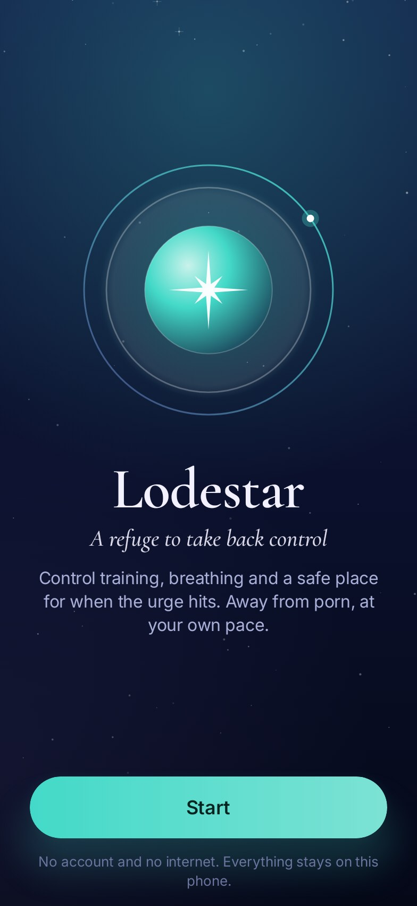
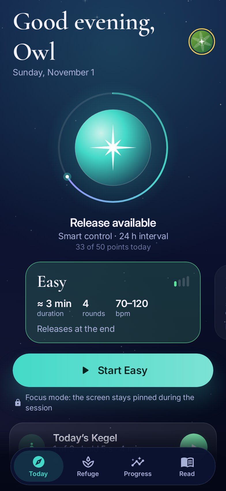
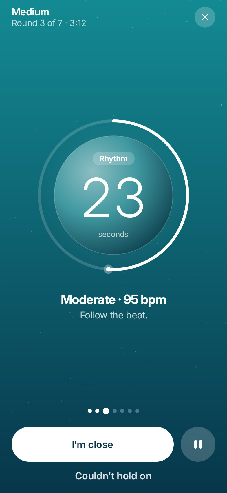
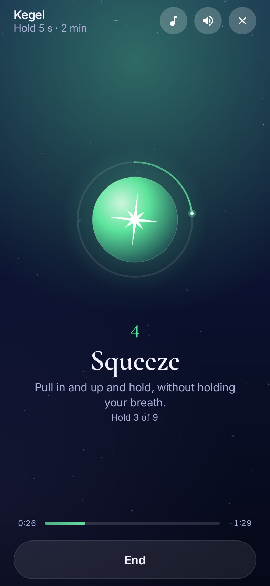
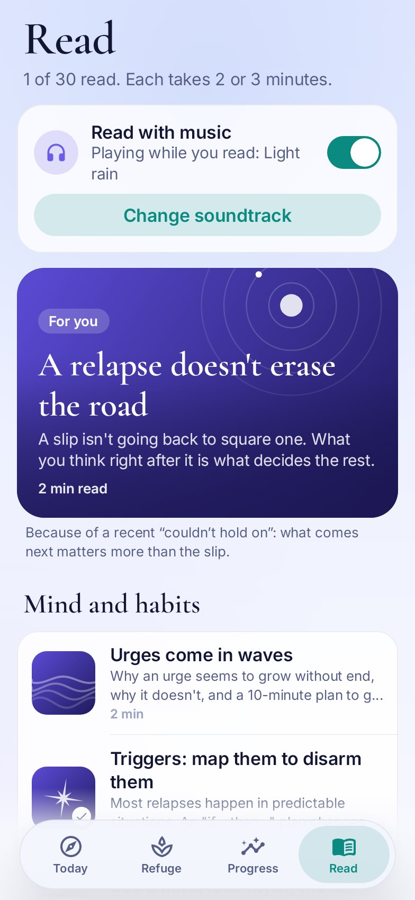

<p align="center">
  
</p>

<h1 align="center">Lodestar</h1>

<p align="center"><i>Compasso in Portuguese · Astrolabio in Spanish</i></p>

<p align="center">
  <b>A refuge to take back control.</b><br>
  Quit porn at your own pace, with control training, Kegel, breathing and readings backed by science.<br>
  100% offline · no ads · no tracking · open source
</p>

<p align="center">
  <a href="https://github.com/H3yK0/Compasso/releases/latest"></a>
  
  
</p>

<p align="center"><b>English</b> · <a href="README.pt-BR.md">Português</a> · <a href="README.es.md">Español</a></p>

<p align="center">
  
  
  
  
  
</p>

## What it does

- **Control training.** Sessions based on the stop-start method used in sex therapy: rhythm rounds with a beat that
  speeds up, full pauses with guided breathing, an "I'm close" button to stop right away and an honest
  "Couldn't hold on" button. Five levels, and smart rules that space things out so hurry doesn't decide for you.
- **Kegel.** Pelvic floor training, the muscle behind control, up to 3 times a day: hold levels (3 to 10 s, unlocked
  step by step) and time levels (2 to 6 min), with a vibration on each change so you can train with your eyes closed.
- **A refuge for when the urge hits.** Two minutes of guided breathing with 6 calm soundtracks generated live by the
  app, and three original games to keep your mind busy until the wave passes.
- **30 readings with sources.** Short articles on urges, habits, relapse, shame, stress, sleep, alcohol, performance
  anxiety, relationships and Kegel, each one citing its studies at the end. Read them with calm music, if you like.
- **Recommendations that explain why.** A local algorithm looks at your sessions and slips and suggests the next level
  and the next reading, always showing the reason.
- **Progress through consistency.** Points reward showing up, not "doing more": daily check-in, Kegel, breathing,
  reading. Levels from Beginner to Unbeaten, your sky for the month, charts and records.

## Privacy first

- **No internet permission.** Nothing leaves your phone. No account, no ads, no tracking.
- Optional PIN, discreet mode (hidden from recents, no screenshots), no cloud backup.
- Optional phone reminders are local and discreet: they only show the app's name, never "Kegel".

## Download

- **[GitHub Releases](https://github.com/H3yK0/Compasso/releases/latest)**: signed APK.
- **F-Droid**: submitted, under review.

Builds are reproducible: F-Droid compiles the same source and checks it matches the signed APK. Signing certificate
SHA-256: `c98ea9ad403d51fbb661afa0e7c1d936c497b1c3ebca76be9488b0f09113356c`

## Languages

English, Portuguese and Spanish, with its own name in each: **Lodestar**, **Compasso** and **Astrolabio**. The app
follows your phone's language, or you can choose one in Settings.

## Build

Requires JDK 17+ and the Android SDK (platform 35).

```
./gradlew assembleRelease      # APK in app/build/outputs/apk/release/
./gradlew testDebugUnitTest    # logic, screens and full user flows
```

Technical documentation (in Portuguese): [docs/tecnico.md](docs/tecnico.md). F-Droid recipe and release steps:
[fdroid/](fdroid/README.md).

## License

- Code: [GNU Affero General Public License v3.0](LICENSE). Copyright (C) 2026 H3yK0.
- Articles (`app/src/main/assets/artigos`): Creative Commons BY-SA 4.0.
- Fonts: Inter and Cormorant Garamond, SIL Open Font License 1.1.

This app is a support tool and doesn't replace a health professional. If you're struggling, reach out to someone you
trust or a local helpline ([findahelpline.com](https://findahelpline.com)).
