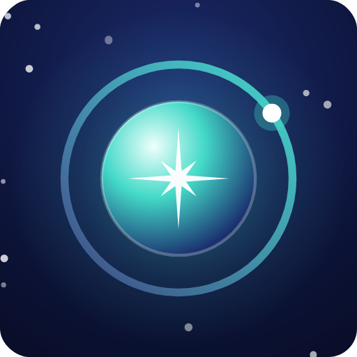
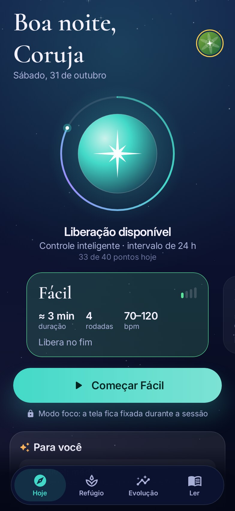
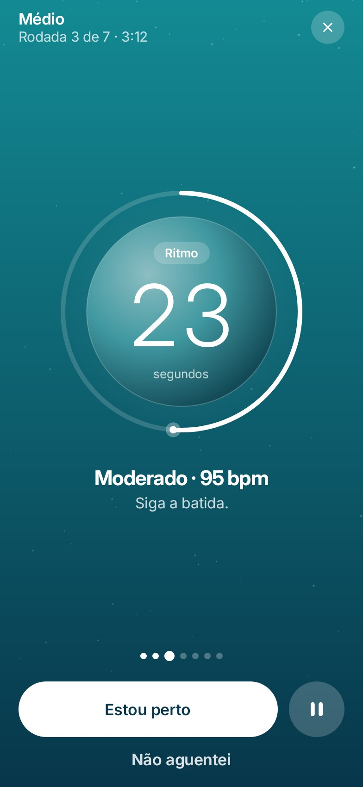
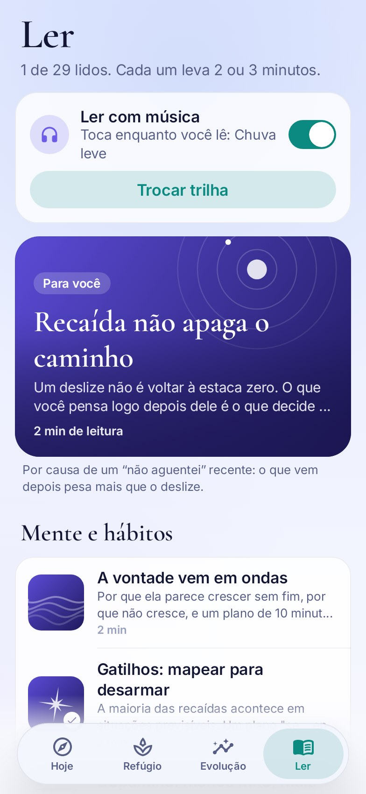
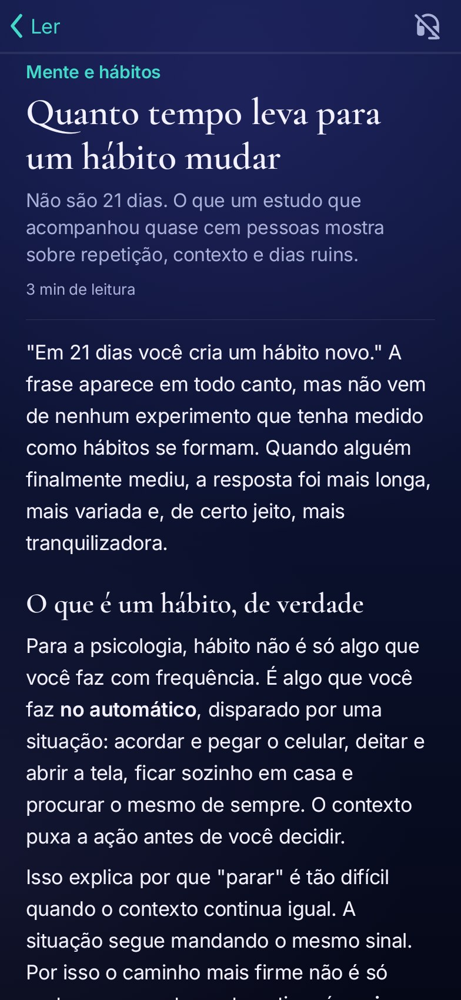

<p align="center">
  
</p>

<h1 align="center">Compasso</h1>

<p align="center"><i>Lodestar em inglês · Astrolabio em espanhol</i></p>

<p align="center">
  <b>Um refúgio para retomar o controle.</b><br>
  Sair da pornografia no seu ritmo, com treino de controle, Kegel, respiração e leituras com base na ciência.<br>
  100% offline · sem anúncios · sem rastreamento · código aberto
</p>

<p align="center">
  <a href="https://github.com/H3yK0/Compasso/releases/latest"></a>
  
  
</p>

<p align="center"><a href="README.md">English</a> · <b>Português</b> · <a href="README.es.md">Español</a></p>

<p align="center">
  
  
  
  
  
</p>

## O que ele faz

- **Treino de controle.** Sessões pelo método "para e recomeça", usado na terapia sexual: rodadas de ritmo com uma
  batida que acelera, pausas totais com respiração guiada, o botão "Estou perto" para parar na hora e o botão honesto
  "Não aguentei". Cinco níveis e regras inteligentes que espaçam as liberações para a pressa não decidir por você.
- **Kegel.** Treino do assoalho pélvico, o músculo do controle, até 3 vezes por dia: níveis de permanência (3 a 10 s,
  liberados aos poucos) e de tempo (2 a 6 min), com vibração a cada troca para treinar de olhos fechados.
- **Um refúgio para quando a vontade apertar.** Dois minutos de respiração guiada com 6 trilhas calmas geradas ao vivo
  pelo app e três jogos originais para ocupar a cabeça até a onda passar.
- **30 leituras com fontes.** Artigos curtos sobre vontade, hábitos, recaída, vergonha, estresse, sono, álcool,
  ansiedade de desempenho, relacionamentos e Kegel, cada um com os estudos no fim. Dá para ler com música calma.
- **Recomendações que explicam o porquê.** Um algoritmo local olha suas sessões e tropeços e sugere o próximo nível e
  a próxima leitura, sempre mostrando o motivo.
- **Evolução por constância.** Os pontos premiam aparecer, não "fazer mais": check-in, Kegel, respirar, ler. Níveis de
  Iniciante a Invicto, o céu do mês, gráficos e recordes.

## Privacidade em primeiro lugar

- **Sem permissão de internet.** Nada sai do celular. Sem conta, sem anúncios, sem rastreamento.
- Senha opcional, modo discreto (some dos recentes, bloqueia prints) e sem backup na nuvem.
- Lembretes opcionais no celular são locais e discretos: mostram só o nome do app, nunca "Kegel".

## Baixar

<a href="https://github.com/ImranR98/Obtainium"></a>

- **Obtainium** (recomendado): instala o app direto dos Releases do GitHub e mantém atualizado. Instale o
  [Obtainium](https://github.com/ImranR98/Obtainium), toque em **Add App** e cole `https://github.com/H3yK0/Compasso`.
- **[Releases do GitHub](https://github.com/H3yK0/Compasso/releases/latest)**: o APK assinado, para instalar à mão.
- **F-Droid**: previsto para fevereiro de 2027. O F-Droid pede 3 meses de desenvolvimento ativo antes de incluir um
  app, e o build já está pronto para ser reproduzível lá.

SHA-256 do certificado de assinatura, para conferir o APK (por exemplo com o AppVerifier):
`c98ea9ad403d51fbb661afa0e7c1d936c497b1c3ebca76be9488b0f09113356c`. Onde o app é publicado e por quê:
[docs/distribuicao.md](docs/distribuicao.md).

## Idiomas

Português, inglês e espanhol, com um nome próprio em cada: **Compasso**, **Lodestar** e **Astrolabio**. O app segue o
idioma do celular, ou você escolhe em Ajustes.

## Compilar

Precisa do JDK 17+ e do Android SDK (plataforma 35).

```
./gradlew assembleRelease      # APK em app/build/outputs/apk/release/
./gradlew testDebugUnitTest    # lógica, telas e fluxos completos
```

Documentação técnica: [docs/tecnico.md](docs/tecnico.md). Receita do F-Droid e passo a passo das versões:
[fdroid/](fdroid/README.md).

## Licença

- Código: [GNU Affero General Public License v3.0](LICENSE). Copyright (C) 2026 H3yK0.
- Artigos (`app/src/main/assets/artigos`): Creative Commons BY-SA 4.0.
- Fontes: Inter e Cormorant Garamond, SIL Open Font License 1.1.
- Selo do Obtainium (`docs/badges/obtainium.png`): do projeto Obtainium, GPL-3.0.

O app é uma ferramenta de apoio e não substitui um profissional de saúde. Se estiver difícil, fale com alguém de
confiança ou com o CVV (188, ligação gratuita, 24 horas).
